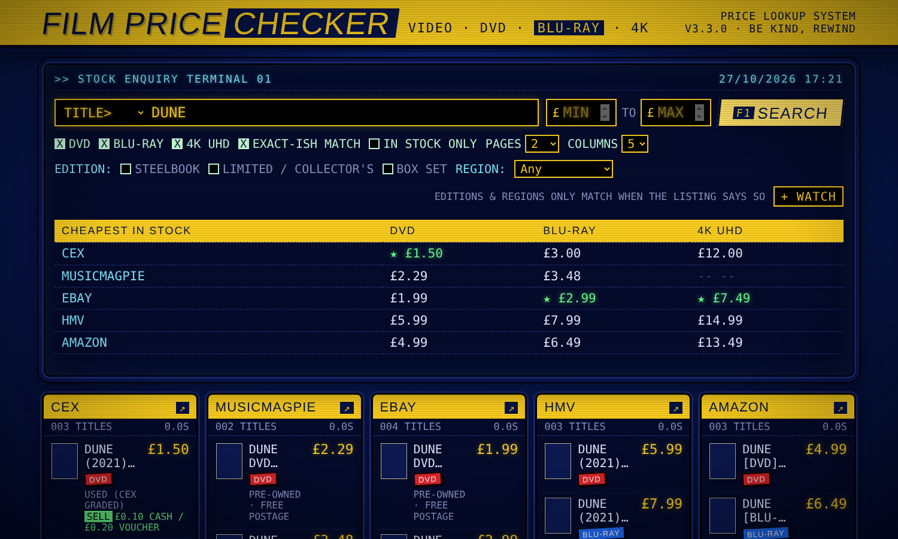
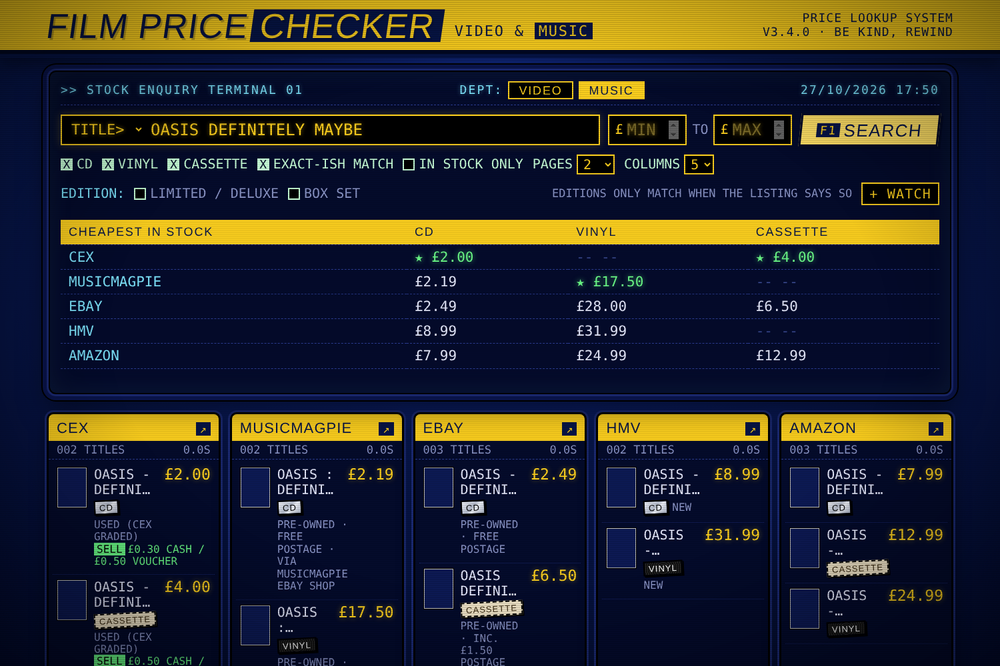
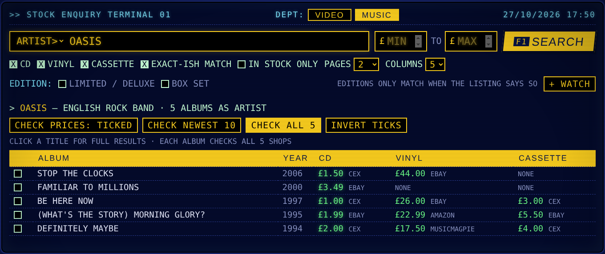
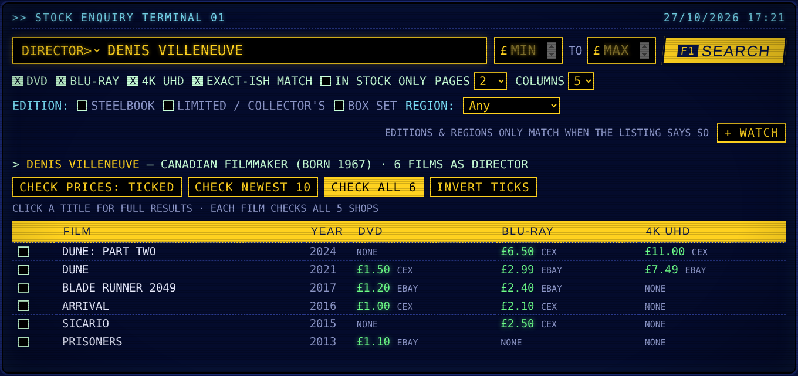
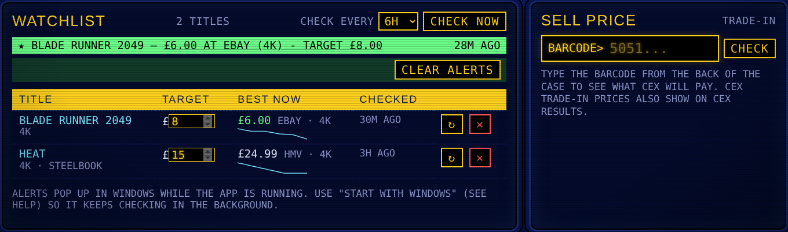

# 📼 Film Price Checker

**Compare DVD, Blu-ray and 4K UHD film prices — and CD, vinyl and cassette music prices — across UK shops (CeX, musicMagpie, eBay, HMV and Amazon) from one retro video-store terminal.**

Type a film, an actor or a director — or switch to the **Music** department and type an album or artist — and see every shop's price side by side, with the cheapest highlighted. Set a target price and it'll pop up a Windows notification when a film drops below it.


<sub>Screenshots use sample data.</sub>

---

## Features

- **5 shops at once** — CeX, musicMagpie, eBay, HMV and Amazon UK, searched in parallel
- **Cheapest-in-stock table** for DVD, Blu-ray and 4K UHD, with the best price for each format starred
- **eBay prices include postage**, so totals are comparable
- **Two departments** — **Video** (DVD / Blu-ray / 4K UHD) and **Music** (CD / vinyl / cassette), each searching the shops' own film or music sections
- **Search by title, director, actor or artist** — look up a filmography or discography and price-check all of it in one go
- **Filters** — price range, format, in-stock only, Steelbook, Limited/Collector's/Deluxe (incl. coloured and picture-disc vinyl), box sets, region (B/2, region free, A/1)
- **Browse mode** — leave the title blank and set a price range to list everything in it (e.g. every Blu-ray under £2)
- **Watchlist with price alerts** — save a film with a target price; it checks in the background and sends a Windows notification when it's at or under your target, with a little price-history graph
- **Sell prices** — see what CeX will pay (cash / voucher) on CeX results, or look up any disc by barcode
- **Retro look** — 90s rental-store sign, CRT terminal screen, rental-sticker format labels. F1 to search, Esc to clear
- **Runs entirely on your own PC** — no accounts, no sign-ups, nothing sent anywhere except the searches themselves

| Music department | Artist search |
|---|---|
|  |  |

| Director / actor search | Watchlist & sell prices |
|---|---|
|  |  |

---

## Install (Windows 10 / 11)

1. **Download** — click the green **Code** button on this page → **Download ZIP**, and unzip it somewhere permanent, e.g. `C:\FilmPriceChecker`.
   *(Don't run it from inside the zip or your Downloads folder if you tend to clear that out.)*
2. **Double-click `install.bat`.**
   - If you don't have Python, it offers to install it for you — then just run `install.bat` again.
   - It sets up a private copy of everything it needs inside the folder, so it won't interfere with anything else on your PC.
   - It asks whether to **start with Windows** (say yes if you want watchlist alerts to keep working in the background).
3. **Use the "Film Price Checker" icon** it puts on your desktop. It opens in your web browser.

Click **QUIT** (bottom right of the page) to stop it.

> Windows may show a blue "Windows protected your PC" box the first time you run `install.bat`, because it's a script downloaded from the internet. Click **More info → Run anyway**. You can open the `.bat` files in Notepad first to see exactly what they do.

### Upgrading to a new version
Don't uninstall first. Unzip the new version and copy its files **over the top** of your existing folder (choose **Replace**), then double-click **`install.bat`** again. It closes the app if it's running, updates only what's changed, and keeps your watchlist and desktop icon.

### Uninstall
Double-click **`uninstall.bat`**, then delete the folder.

### Mac / Linux (manual)
```bash
python3 -m venv .venv && source .venv/bin/activate
pip install -r requirements.txt curl_cffi
python -m playwright install chromium
python filmprice.py
```
Desktop shortcuts, start-up and notifications are Windows-only; everything else works.

---

## How to use

| To… | Do this |
|---|---|
| Find a film | Type the title, press **Search** (or F1) |
| Find music | Click **Music** next to *Dept:*, type the album (adding the artist helps, e.g. *Oasis Definitely Maybe*), tick CD / Vinyl / Cassette |
| See an artist's albums | In **Music**, switch **TITLE>** to **ARTIST>** and type the band or singer, then **Check all** |
| Search by person | Switch **TITLE>** to **DIRECTOR>** or **ACTOR>**, type a name. Pick "Not them?" if it chose the wrong person, then **Check all** or tick films |
| Browse a price range | Leave the title blank, set **Min £ / Max £**, tick formats |
| Hunt for special editions | Tick **Steelbook**, **Limited / Collector's** (**Limited / Deluxe** in Music) or **Box set**, and/or pick a **Region** |
| Get a price alert | Type a title, put your target in **Max £**, press **+ Watch** |
| See what CeX pays | Look for the green **SELL** line on CeX results, or type a barcode (film or music) into **Sell price** |
| More results | Raise **Pages** (slower) |
| Change the layout | **Columns**: 3, 4 or 5 shops per row |

Edition and region filters only match when the shop's listing actually mentions them.

---

## Troubleshooting

Run **`run.bat --selftest`** (or `python filmprice.py --selftest`). It tests the film & music database and every shop (a film search and a music search) and prints PASS / FAIL for each, also saved as `selftest.txt`.

| Problem | Fix |
|---|---|
| A shop says it's blocked / bot check | Shops sometimes challenge automated searches. Wait a minute and try again. If one keeps failing, run `run.bat --headed` — the helper browser becomes visible so you can tick any "verify you're human" box once. |
| A shop always shows no results | Its website may have changed. Run `run.bat --debug`, search again, and open an issue attaching that shop's file from the `debug` folder. |
| Nothing opens when I click the icon | Run `run.bat` to see the messages. If it says the port is in use, another copy is already running — the icon just opens that one. |
| Director / actor / artist search errors | It uses the free Wikidata database, which occasionally rate-limits. Wait a few minutes. |
| No price-alert notifications | The app must be running (use the start-with-Windows option), and Windows notifications must be allowed for PowerShell in **Settings → System → Notifications**. |

Optional: free [eBay developer keys](https://developer.ebay.com) make eBay faster and more reliable — set `EBAY_CLIENT_ID` and `EBAY_CLIENT_SECRET` as Windows environment variables.

---

## Privacy & safety

- The app only listens on your own PC (`127.0.0.1`) — other devices and websites can't use it.
- It never signs in to anything and never touches your normal browser, its passwords or cookies. Blocked shops are opened in a separate helper browser (Edge or Chrome) with its own profile in the app folder.
- Your watchlist, log and settings stay in the app folder. `.gitignore` keeps them out of Git.
- Searches go only to the shops themselves and to [Wikidata](https://www.wikidata.org) for director / actor / artist lookups.

## Good to know

- **Not affiliated** with CeX, musicMagpie, eBay, HMV, Amazon or Wikidata. All trademarks belong to their owners.
- **For personal, occasional use.** It reads the shops' public search pages the way a browser does; automated access may be against some sites' terms, and heavy use can get you temporarily blocked. Please be considerate.
- **Always check the price on the shop's page before buying** — listings change quickly, and the app reads prices from pages that can change layout.
- Film and album data from Wikidata (CC0). Zavvi was supported until it ceased trading in October 2026.

## Licence

**[PolyForm Noncommercial 1.0.0](https://polyformproject.org/licenses/noncommercial/1.0.0)** — see [LICENSE](LICENSE).

- ✅ **Free for personal and other non-commercial use** — use it, share it with friends, fork it and change it.
- ❌ **No commercial use** — you may not sell it, sell anything built on it, or use it to run a paid service, without a separate commercial licence.
- 💬 **Want to use it commercially?** Open an issue on this repository to ask about a commercial licence.

When you share it, keep the `LICENSE` file (including its `Required Notice` lines) with it.
